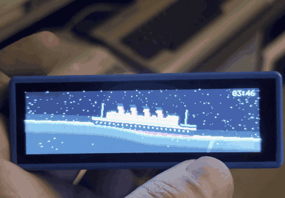
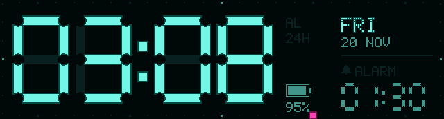
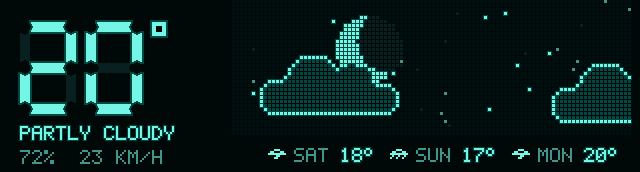
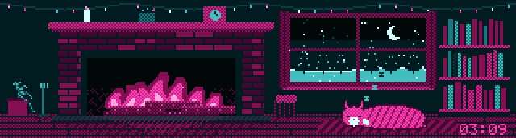

# Phosphor

A retro VFD-style desk gadget for the **Waveshare ESP32-S3-Touch-LCD-3.49** (640×172 bar display). Clock, weather,
internet radio, focus timer and a set of slow pixel scenes, all drawn to look like an old vacuum-fluorescent display.



**[Install from the browser →](https://melihkoray.github.io/phosphor/)** (Chrome or Edge, USB cable, no tools needed)

> [!WARNING]
> Installing replaces whatever runs on the board now, the Waveshare factory demo included. It is not backed up and
> Phosphor cannot restore it. On a first install, tick **Erase device** in the installer for a clean start.

## What it does

| | |
|---|---|
|  | **Clock.** Big segment digits, date, battery, 12 or 24 hour. Alarm: tap the right column to switch it on and set the time; it wakes you with the radio. |
|  | **Weather.** Now and the next three days for your city ([Open-Meteo](https://open-meteo.com), no key). |
|  | **Internet radio.** Up to 7 genre buttons; tap again for the next station. Tested with MP3 and AAC streams. |
|  | **Timer.** Add or remove 1, 5 or 10 minutes by touch, up to 99; it rings at the end. |
|  | **Focus timer.** Pomodoro rounds in a little study room. |

Pixel scenes, to leave running: aquarium, snowy cabin, fireplace with a sleeping cat, seaside that follows the time of day, an ocean liner
that tilts with the board, a lava lamp and an hourglass you turn over.

|  |  |
|---|---|
|  |  |

## Setup

1. Open the [installer page](https://melihkoray.github.io/phosphor/), connect the board with a USB-C data cable, press
   **Install Phosphor** and pick **USB JTAG/serial debug unit** from the port list (`cu.usbmodem…` on a Mac, `COMx` on
   Windows, `ttyACM0` on Linux). Not sure? Unplug the board and plug it back in: the entry that comes back is the board.
2. The board restarts and shows a Wi-Fi name like `Phosphor-Setup-1A2B` and a QR code. Join it from your phone (no
   password); a setup page opens. If it does not, or the browser shows normal websites, turn off mobile data and type
   `http://192.168.4.1` in the browser (if you see a menu, tap **Configure WiFi**). Tap your
   home Wi-Fi (2.4 GHz), type its password, scroll down to **Device name** (prefilled as `phosphor-1a2b`, change it to
   something short like `desk` if you like) and tap **Save**. **Write the name down: you need it in the next step and
   the board does not show it anywhere.**
3. With the phone back on your home Wi-Fi (mobile data on again), open `http://<device name>.local/settings` with the
   name from step 2, for example `http://desk.local/settings`. If the phone cannot open `.local` addresses
   (some Android phones), use the board's IP address from your router's device list. There you set:
   - **City:** search by name; weather and the time zone follow it.
   - **Language:** English or Turkish screen texts.
   - **Clock:** 12 or 24 hour.
   - **Focus timer:** focus, short and long break minutes.
   - **Radio:** groups and stations. Search [Radio Browser](https://www.radio-browser.info) or paste a stream URL,
     test it on the device, reorder, delete, export the list to a file and import it again.

Settings are stored on the board and survive restarts and updates (a reinstall with **Erase device** clears them).

**Touch:** swipe left for the next page, right for the previous one, up or down for the volume; taps work the page's
own buttons. Hold on the clock to switch the alarm on or off, hold on a timer to reset it. Back buttons: PWR turns the
screen off and on (hold 3 s on battery to power off), BOOT changes brightness (hold 5 s to forget Wi-Fi and open the
setup again), RESET restarts.

## Troubleshooting

- **No "USB JTAG/serial debug unit" in the port list:** try another cable (many only charge) or USB port. Still
  nothing: hold BOOT while plugging the cable in.
- **The board does not join your Wi-Fi:** most often a mistyped password (phones capitalise the first letter); hold
  BOOT for 5 seconds and try again. The ESP32 also only works with 2.4 GHz: pick the non-5G network if there are two.
- **The setup Wi-Fi or page is gone:** hold BOOT for 5 seconds. The board forgets the saved Wi-Fi and opens the setup
  again until you finish it. (After a restart with a failing saved Wi-Fi it opens by itself, but only for 3 minutes.)
- **The setup page does not open, or the browser shows normal websites:** the phone is on mobile data. Turn it off,
  stay joined to `Phosphor-Setup-…` ("no internet" is normal) and type `http://192.168.4.1` in the browser.
- **Forgot the device name:** look in your router's list of connected devices, or hold BOOT for 5 seconds and set up
  the Wi-Fi again.
- **`desk.local` does not open:** be on the same Wi-Fi as the board. Some Android phones cannot open `.local`: use a
  computer, or the board's IP from your router's device list (`GET /status` also shows it).
- **A station does not play:** use Test on the settings page. MP3 and AAC streams are tested.

## Building it yourself

Needs [arduino-cli](https://arduino.github.io/arduino-cli/) and the ESP32 core:

```bash
arduino-cli core install esp32:esp32@3.3.12 --additional-urls https://espressif.github.io/arduino-esp32/package_esp32_index.json
```

```bash
./build.sh                          # compile; output in build/
./build.sh /dev/cu.usbmodem101      # compile and flash over USB
```

To update over Wi-Fi, copy `firmware/secrets.h.example` to `firmware/secrets.h`, set a long random `OTA_TOKEN`, flash
once over USB, then `./build.sh desk.local`. Without a token, Wi-Fi updates are switched off.

Every push to `main` is built by GitHub Actions and published to the installer page; tags (`v1.0.0`) become releases.

## HTTP API

The main endpoints, plain HTTP on your local network (`GET /status` also tells you the board's IP address):

| Request | |
|---|---|
| `GET /status` | JSON status (IP, page, battery, ...) |
| `GET /screen` | the current screen, raw RGB565 640×172 |
| `POST /page` `name=clock\|radio\|weather\|timer\|aquarium\|snow\|fire\|sea\|study\|wave\|lava\|hourglass` | show a page |
| `POST /cmd` `name=radio arg=next\|stop\|<index>` | radio control (also `vol`, `alarm`, `timer`, `theme arg=vfd\|ega\|natural`) |
| `POST /text` `text=... title=... ttl=60` | show a message |
| `GET/POST /api/settings` | the settings as `key=value` lines (POST needs the header `X-Phosphor: 1`) |
| `POST /update` | firmware update, needs the `X-Token` header (see above) |

## Security notes

- The device is meant for a home network. Pages, radio, brightness and messages can be changed by anyone on the same
  Wi-Fi, without a password. Only settings writes need a custom header (`X-Phosphor`), so other websites open in your
  browser cannot change them. Do not expose the device to the internet.
- Firmware updates, renaming and Wi-Fi reset over the network need `OTA_TOKEN`; the published builds have none, so
  those are off.
- There is no microphone code and no cloud account. The board talks to Open-Meteo (weather), NTP servers (time) and the
  radio streams you choose (weather is fetched over plain HTTP); the settings page in your phone's browser also talks to Open-Meteo geocoding and Radio Browser.

## Credits and license

GPL-3.0, see [LICENSE](LICENSE). Uses [ESP32-audioI2S](https://github.com/schreibfaul1/ESP32-audioI2S) (GPL-3.0,
vendored in `libraries/`), [U8g2](https://github.com/olikraus/u8g2) (BSD-2-Clause),
[WiFiManager](https://github.com/tzapu/WiFiManager) (MIT), [SensorLib](https://github.com/lewisxhe/SensorLib) (MIT),
the Espressif AXS15231B display and touch drivers (Apache-2.0) and
[ESP Web Tools](https://esphome.github.io/esp-web-tools/) for the installer. Not affiliated with Waveshare.

Made by [Melih Koray](https://melihkoray.com).
